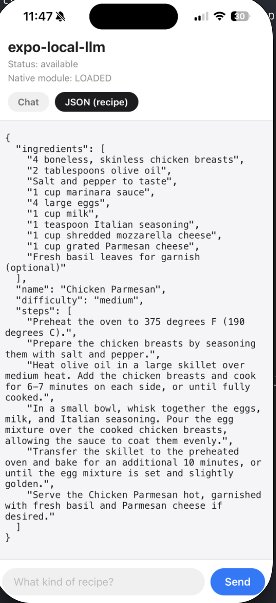

# expo-local-llm

[](https://www.npmjs.com/package/expo-local-llm)
[](https://github.com/GijungKim/expo-local-llm/actions/workflows/ci.yml)
[](https://github.com/GijungKim/expo-local-llm/actions/workflows/native.yml)
[](LICENSE)

**On-device AI. No bundled model weights. No additional npm runtime dependencies.**

Use system-provided models in Expo apps: Apple Foundation Models on iOS 26+ and Gemini Nano on Android. Generate text, stream it into a component, extract typed objects and call tools, with no API key.

The full JavaScript API measures approximately **17.8 kB minified / 6.0 kB gzipped**, excluding external dependencies and native code.[^js-size]

Inference stays on the device, with no cloud fallback. Once the model is ready, generation works offline; initial model provisioning or downloads may require network access and device storage. Tool handlers you write may also access the network.

[^js-size]: Measured from the built package entry point with Bun 1.4.4: a minified browser-target ESM bundle, all public exports retained, packages external, and default `node:zlib` gzip compression. Sizes use decimal kB. This standalone JS measurement excludes Expo, React, React Native, native SDKs (including Android ML Kit), and model assets; it is not a Metro/Hermes or installed-app size measurement. Reproduce with `bun run build && bun run check:size`. CI enforces budgets of 18,000 minified bytes and 6,200 gzip bytes.

[Setup](#quick-start) · [Usage](#usage) · [API reference](docs/api.md) · [Troubleshooting](docs/troubleshooting.md) · [Changelog](CHANGELOG.md)

## At a glance

| | iOS 26+ (Foundation Models) | Android (Gemini Nano) |
|---|---|---|
| Text generation and streaming | ✅ Verified on device | ✅ Implemented |
| Image prompts | iOS 27+, Xcode 27+, and a ready vision-capable system model | ✅ Up to eight images; requires model vision support |
| Structured results (`generateObject`) | ✅ Native constraints + JS validation | ✅ JS schema validation and bounded repair |
| Native schema constraints | ✅ Runtime schemas | Unavailable for runtime schemas in ML Kit; automatic mode uses validation instead |
| Tool calling (validated primitive arguments) | ✅ Schema-constrained | ✅ Native tools; selected model must advertise function calling |
| Stable error codes | ✅ | ✅ |
| Model download | Managed by the OS | `downloadModel()` with progress |

**Checkmarks indicate implemented features, not hardware certification.** Android session behavior is covered by automated tests, and real SDK image requests are tested on an emulator. Gemini Nano inference has not yet been validated on eligible hardware. See the [verification record](docs/release-verification.md) for evidence and remaining device checks.

Unsupported features fail with a clear error instead of degrading silently. `getCapabilities()` reports integration support, including the path selected by `objectGenerationMode`; `getModelReadiness()` reports selected-model readiness and tool support. `structuredOutput` continues to describe native constrained output only. See [how this library is verified](#how-this-library-is-verified).

## Quick start

Use an existing Expo app and a native development build; **Expo Go is not supported**. Generation needs Apple Intelligence on iOS 26+ or an eligible Gemini Nano device on Android. A successful build does not establish device eligibility. Check the [requirements](#requirements) before choosing a test device.

```bash
npx expo install expo-local-llm expo-dev-client expo-build-properties
```

Set the deployment targets the module needs in `app.json`:

```json
{
  "expo": {
    "plugins": [
      [
        "expo-build-properties",
        {
          "ios": { "deploymentTarget": "16.4" },
          "android": { "minSdkVersion": 26, "kotlinVersion": "2.3.0" }
        }
      ]
    ]
  }
}
```

Build a development app, since stock Expo Go cannot load native modules:

```bash
npx expo run:ios --device
# Or, for Android:
# npx expo run:android --device
```

Then stream a response:

```tsx
import { Button, Text } from 'react-native';
import { useLocalLLM } from 'expo-local-llm';

export function Summary({ notes }: { notes: string }) {
  const { availability, streamResponse, streamedText, isGenerating, error } = useLocalLLM({
    instructions: 'Summarise the text in two sentences.',
  });

  async function summarise() {
    if (!streamResponse || isGenerating) return;
    try {
      await streamResponse(notes);
    } catch {
      // The hook exposes the rejection through `error`, rendered below.
    }
  }

  return (
    <>
      <Text>Model: {availability}</Text>
      <Button
        title={isGenerating ? 'Summarising…' : 'Summarise'}
        disabled={!streamResponse || isGenerating}
        onPress={summarise}
      />
      <Text>{error ?? streamedText}</Text>
    </>
  );
}
```

`streamResponse` is `undefined` until the model is ready. `availability` distinguishes an ineligible device, disabled Apple Intelligence, a pending download, and other states. Android apps can expose the hook's `downloadModel()` when availability is `downloadRequired`; see [readiness and downloads](docs/troubleshooting.md#model-not-ready).

The hook retains conversation history between requests. Use `reset()` for a new conversation or [`generate()`](#one-shot-generation) for independent tasks.

### Upgrading to 0.10.0

All Android apps now require **Kotlin 2.3.0+**, including text-only apps; set `kotlinVersion` as shown above or update your native Kotlin Gradle plugin. Rebuild your iOS or Android app to include the new native image and tool APIs. An EAS Update alone cannot install them.

Version 0.10.0 makes `generateObject()` automatic: iOS uses native constraints and Android uses validation with bounded repair. Pass `mode: 'constrained'` to require native constraints. Capability objects now require `objectGenerationMode`, and `experimental` is `false` for both integrations; device verification is documented separately. Hook/session `responseFormat: 'json'` remains iOS-only. See the [changelog](CHANGELOG.md).

## Requirements

| | Requirement |
|---|---|
| iOS | iOS 26+ with Apple Intelligence enabled to generate. The module loads on iOS 16.4+ and reports `notEligible` below 26. The host project must target iOS 16.4+, and building needs Xcode 26.4 or newer. |
| Android | `minSdkVersion` 26+ and Kotlin 2.3.0+ to compile ML Kit beta5. Generation needs an eligible Gemini Nano device; query readiness on the target device before offering generation. |
| Expo SDK | 52+ peer range. The example app targets SDK 58 / React Native 0.88; the peer range is not a tested compatibility matrix. |

A native development build is required, built locally or with EAS Build. Installing or upgrading the package needs a new binary; EAS Update cannot add native code. An iPhone simulator can run Foundation Models when the host Mac has Apple Intelligence enabled; latency and thermals still need real hardware.

If the project targets an iOS version below 16.4, the build fails with `module 'ExpoLocalLlm' has a minimum deployment target of iOS 16.4`. The 16.4 floor is for compilation only; generation still needs iOS 26.

For setup failures, unavailable models and unsupported features, see [troubleshooting](docs/troubleshooting.md).

### Xcode 27 requires scene support

Apps built with the iOS 27 SDK must adopt the UIKit scene lifecycle, or UIKit stops them at launch before any JavaScript runs. Expo SDK 58 apps adopt it by default, so there is nothing to set. Expo SDK 57 apps opt in through `expo-build-properties` (Expo `57.0.23`+, `expo-build-properties` `57.0.20`+):

```json
{
  "expo": {
    "plugins": [
      [
        "expo-build-properties",
        { "ios": { "deploymentTarget": "16.4", "enableSceneSupport": true } }
      ]
    ]
  }
}
```

Then regenerate and rebuild the native app. This is an app-level build setting, not something this library can enable for you.

## Usage

| Task | API | Session ownership |
|---|---|---|
| Stream into a React component or keep a conversation | `useLocalLLM()` | The hook creates and releases its session |
| Generate one independent response | `generate()` | Released after the request |
| Extract a typed object | `generateObject()` | Released after each attempt |
| Invoke your app's tools | `useLocalLLM({ tools })` | The hook dispatches handlers |
| Manage events and conversation lifetime yourself | `createLLMSession()` | You must call `release()` |

The [quick start](#quick-start) shows streaming with the hook. For all options and return types, see the [API reference](docs/api.md).

### One-shot generation

For a single call with no conversation history, such as classifying or rewriting one message, use `generate()`. It creates a session, responds once and releases it:

```ts
import { generate } from 'expo-local-llm';

const title = await generate('Suggest a short title for this note: ...', {
  instructions: 'Reply with the title only.',
});
```

<a id="describe-an-image"></a>

### Describe or compare images

Pass a prompt object to `generate()`, `session.respond()`, `session.streamResponse()`, or the hook's `respond` / `streamResponse`:

```ts
import { generate } from 'expo-local-llm';

// photoUri is a local file:// URI, for example from your app's cache.
const description = await generate({
  text: 'Describe the photo in one sentence.',
  images: [{ uri: photoUri, label: 'photo' }],
});
```

Attach up to **eight local images** with unique labels. For a comparison:

```ts
// Both URIs point to local files already available to your app.
const comparison = await generate({
  text: 'What changed between the before and after photos?',
  images: [
    { uri: beforePhotoUri, label: 'before' },
    { uri: afterPhotoUri, label: 'after' },
  ],
});
```

iOS images require **iOS 27+, Xcode 27+, and a ready vision-capable model**. Android image support depends on the selected model. Use `getCapabilities().images` to inspect support; a ready text model does not guarantee vision support.

Images must use local `file://` URIs; download remote images first. iOS retains completed image turns in session history. Android retains images during the current request and its tool turns, but you must attach them again on a later request. See [image requirements, capabilities, and errors](docs/images.md) for URI rules, limits, and cancellation behavior.

### Extract typed data

`generateObject()` infers the result type from the schema and automatically selects the strongest available path. iOS uses native constrained decoding. Android generates text, validates every field in JavaScript, and makes at most one repair request after invalid JSON or a schema mismatch. Check `objectGenerationMode` to inspect the selected path:

```ts
import { generateObject, getCapabilities } from 'expo-local-llm';

if (getCapabilities().objectGenerationMode !== 'unsupported') {
  const result = await generateObject('Classify: "Can we move the meeting to Friday?"', {
    instructions: 'Classify the message by its primary intent.',
    schema: {
      intent: { type: 'string', enum: ['scheduling', 'question', 'other'] },
    },
  });
  // result.intent: 'scheduling' | 'question' | 'other'
}
```

A supported capability does not mean the model is ready, so handle rejected calls. Provider failures never switch paths or trigger repair. Exhausted schema repair rejects with `StructuredOutputValidationError`.

<p align="center">
  
</p>

*Real device output: the model fills in a recipe schema with `difficulty` constrained to `easy | medium | hard`. The streaming demo lives at `example/App.tsx`.*

### Choose the structured-output path explicitly

The default `mode: 'auto'` is portable. Request `mode: 'constrained'` to require native constraints and reject when unavailable, or `mode: 'validated'` to force ordinary text generation plus complete JSON validation. Validated mode does **not** constrain decoding. `structuredOutput` and `structuredOutputMode` describe native constraints; `objectGenerationMode` describes automatic routing.

```ts
import { generateObject, getCapabilities, getModelReadiness } from 'expo-local-llm';

const controller = new AbortController();
if (getCapabilities().text && (await getModelReadiness('default')).availability === 'available') {
  const result = await generateObject('Classify: "Can we meet on Friday?"', {
    mode: 'validated',
    repairAttempts: 1, // default; choose 0 to disable repair
    signal: controller.signal,
    androidModel: 'default',
    schema: {
      intent: { type: 'string', enum: ['scheduling', 'question', 'other'] },
      dates: { type: 'array', items: { type: 'string' } },
    },
  });
  // result.intent: 'scheduling' | 'question' | 'other'; result.dates: string[]
}
// Call controller.abort() from your cancel action while the call is pending.
```

Only JSON parse or schema failures permit one additional request. Each attempt uses a fresh session with the original task, schema, instructions, generation options, selected model, and image attachment records. Native errors, refusals, guardrails, cancellation, context limits, and availability failures propagate without repair. Exhausted or disabled repair rejects with `StructuredOutputValidationError`; the helper never extracts JSON from prose, coerces values, inserts fields, or removes extra fields. Validation checks structure, not factual correctness. Both platforms still need device testing of validated mode (automatic on Android or explicit).

Automatic and validated modes are available only in one-shot `generateObject()`. They do not change sessions, hooks, JSON streaming, or Android's rejection of native `responseFormat: 'json'`.

### Structured output in the hook

On iOS, JSON mode in the hook streams a partial object, then publishes the validated result. Android callers should use one-shot [`generateObject()`](#extract-typed-data); the hook does not support automatic or validated JSON generation.

```tsx
const { streamResponse, streamedObject, completedObject } = useLocalLLM({
  responseFormat: 'json',
  schema: {
    name: { type: 'string', description: 'Recipe name' },
    ingredients: { type: 'array', items: { type: 'string' } },
    difficulty: { type: 'string', enum: ['easy', 'medium', 'hard'] },
  },
});

await streamResponse?.('Give me a pasta recipe');
// streamedObject: fields appear as the model writes them (every field optional)
// completedObject: { name: string; ingredients: string[]; difficulty: 'easy' | 'medium' | 'hard' } | null
```

`respond` and `streamResponse` validate the final JSON and reject with `StructuredOutputValidationError` (`ERR_STRUCTURED_OUTPUT_INVALID`) if it does not match. A cancelled stream keeps its partial `streamedObject` and leaves `completedObject` null. `streamedJSON` holds the raw partial JSON.

Schemas are validated before they reach native code; a malformed one throws `SchemaInvalidError` with per-field paths. Call `validateSchema()` yourself when building schemas at runtime.

### Tool calling

Use `defineTool()` to type a handler from its parameters and `useLocalLLM()` to dispatch calls. This example looks up local sample data; replace the handler with your app's data access:

```tsx
import { Button, Text } from 'react-native';
import { defineTool, useLocalLLM } from 'expo-local-llm';

const stock = new Map([['trail-shoes', 12], ['rain-jacket', 0]]);
const lookupStock = defineTool({
  name: 'lookupStock',
  description: 'Look up the available quantity for a product SKU',
  parameters: {
    sku: { type: 'string', description: 'Product SKU, such as trail-shoes' },
  },
  handler: async ({ sku }) => JSON.stringify({ sku, quantity: stock.get(sku) ?? null }),
});

export function InventoryAssistant() {
  const { streamResponse, streamedText, isGenerating, activeToolCalls, error } = useLocalLLM({
    instructions: 'Use lookupStock to answer inventory questions.',
    androidModel: 'previewFast', // Explicit Android preview selection; ignored on iOS.
    tools: [lookupStock],
  });

  async function checkStock() {
    if (!streamResponse || isGenerating) return;
    try {
      await streamResponse('How many trail-shoes are available?');
    } catch {
      // The hook exposes failures through `error`.
    }
  }

  return (
    <>
      <Button title="Check stock" onPress={checkStock} disabled={!streamResponse || isGenerating} />
      {activeToolCalls.length > 0 && <Text>Checking inventory…</Text>}
      <Text>{error ?? streamedText}</Text>
    </>
  );
}
```

Android tool calling requires a selected model that advertises function calling. Check `await getModelReadiness('previewFast')`; both `availability === 'available'` and `tools === 'available'` are needed. Preview access requires eligible hardware and AICore Developer Preview enrollment. There is no automatic fallback to another model.

The model chooses whether to call a tool. Handlers must validate application-specific values and permissions; valid arguments alone do not authorize an action. Return strings, using `JSON.stringify()` for structured results. See [tool requirements, execution limits, and cancellation](docs/tool-calling.md).

### Handle errors

Generation failures and the library's own checks carry a stable `code` (see [Error codes](docs/api.md#error-codes)), so you can respond to *why* generation failed rather than parsing OS messages. The hook exposes it as `errorCode`; for a caught error, use `getLocalLLMErrorCode()`.

Cancellation through validated mode's `AbortSignal` instead rejects with `error.name === 'AbortError'`, without a library error code. Handle it separately from generation failures.

A conversation can fail with `ERR_CONTEXT_WINDOW_EXCEEDED`. Offer a user-triggered `reset()` action for the hook, or start a new session with a summary. Reset clears conversation history; it is not an automatic retry.

```ts
import { generate, getLocalLLMErrorCode } from 'expo-local-llm';

try {
  await generate('Summarise my notes');
} catch (error) {
  if (error instanceof Error && getLocalLLMErrorCode(error) === 'ERR_RATE_LIMITED') {
    // Show a retry-later message in your app.
  } else {
    throw error;
  }
}
```

For an Effect wrapper, see [Using with Effect](docs/effect.md).

## API reference

The [complete API reference](docs/api.md) covers configuration, return types, events, errors, and session ownership.

| API | Reference |
|---|---|
| <a id="getcapabilities"></a>`getCapabilities()` | [Integration and image capabilities](docs/api.md#getcapabilities) |
| <a id="getmodelreadinessandroidmodel-androidmodel"></a>`getModelReadiness()` | [Selected-model readiness](docs/api.md#getmodelreadinessandroidmodel-androidmodel) |
| <a id="getmodulediagnostics"></a>`getModuleDiagnostics()` | [Native module diagnostics](docs/api.md#getmodulediagnostics) |
| <a id="uselocalllmoptions"></a>`useLocalLLM()` | [Options and return values](docs/api.md#uselocalllmoptions) |
| <a id="generateprompt-config"></a>`generate()` | [Independent text generation](docs/api.md#generateprompt-config) |
| <a id="generateobjectprompt-config"></a>`generateObject()` | [Constrained and validated modes](docs/api.md#generateobjectprompt-config) |
| <a id="createllmsessionconfig"></a>`createLLMSession()` | [Manual session ownership](docs/api.md#createllmsessionconfig) |
| <a id="error-codes"></a>Error codes | [Generation and validation failures](docs/api.md#error-codes) |
| <a id="modelavailability"></a>`ModelAvailability` | [Readiness states](docs/api.md#modelavailability) |
| <a id="validateschemaschema-and-validatestructuredoutputvalue-schema"></a>Schema validators | [Validate schemas and objects](docs/api.md#validateschemaschema-and-validatestructuredoutputvalue-schema) |

## Platform differences and limitations

| Concern | iOS | Android |
|---|---|---|
| System instructions | Native `LanguageModelSession(instructions:)` | Prepended to the prompt |
| Conversation history | Kept by the native session | Replayed in the prompt: the last 10 exchanges, with role markers in conversation text neutralised |
| Model availability | Built into the OS | May need `downloadModel()` |
| Token limits | OS and model dependent | SDK and model dependent |
| Image prompts | Up to eight local images per request on iOS 27+ with a ready vision-capable model and an Xcode 27+ build; retained in native history | Up to eight local images per request; device model support is unknown |

- **Context window.** Neither platform trims history to fit the model's context; Android only caps it at 10 exchanges. iOS rejects with `ERR_CONTEXT_WINDOW_EXCEEDED`; call `reset()` or start a new session.
- **One generation per session.** Overlapping requests reject with `ERR_SESSION_BUSY`. After cancelling, await the original promise before starting another request. Use separate sessions for independent conversations; events belong to their session.
- **Guardrails.** Apple's model refuses some categories of prompt, such as interpreting personal health data. A refusal arrives as `ERR_GUARDRAIL_VIOLATION` or `ERR_REFUSAL`.
- **Android model requirements.** The Gemini Nano SDK is in beta and its API may change. Tools require selected-model feature support. Default `generateObject()` uses text generation plus JS validation and bounded repair. Native `responseFormat: 'json'` and explicit `mode: 'constrained'` remain unsupported because ML Kit only accepts compiled Kotlin types for constrained output, with no public runtime-schema entrypoint for arbitrary JS schemas.
- **Readiness gates generation.** `respond` and `streamResponse` need a session and `availability === 'available'`; cancelling and resetting work whenever a session exists.

## How this library is verified

- **Code changes:** lint, unit tests, type-level tests, and a compile of a freshly generated Expo SDK 58 app on both platforms, with the iOS build using Xcode 26.4, the oldest supported toolchain. Android also runs JVM tests of the prompt assembly and error mapping.
- **Against the real model:** [`tools/model-check`](tools/model-check/README.md) runs the library's Foundation Models code on a Mac with Apple Intelligence: constrained tool arguments, error-code mapping and schema-constrained output. The release checklist runs it before each release.
- **On devices:** the [release verification record](docs/release-verification.md) lists the device/OS, package revision, and results for each recorded run, and leaves untested scenarios marked as pending rather than assumed.

## Choosing this library

Choose `expo-local-llm` for a small, Expo-first API around system-provided language models: short text generation, classification, extraction, and streaming interfaces on supported devices. You do not select or distribute model weights.

If you need downloadable models, embeddings, speech, or an AI SDK provider interface, evaluate a broader runtime such as [React Native AI](https://github.com/callstackincubator/ai). Check its current provider documentation for platform requirements. This library does not implement those capabilities or automatically route requests to a cloud model.

### Why an Expo module?

The [Expo Modules API](https://docs.expo.dev/modules/overview/) fits OS-provided AI APIs well:

- **Native session objects** — Expo's `SharedObject` and class DSL expose instance methods and session-scoped events directly to JavaScript.
- **Lifecycle integration** — native cleanup hooks support cancellation and resource release. `generate()` releases its session automatically; consumers of `createLLMSession()` must call `release()` when finished.
- **Swift and Kotlin** — both implementations use a consistent module definition style, without adding a separate inference engine.
- **Expo build workflows** — autolinking integrates with prebuild, local development builds, and EAS Build.

Expo supplies the native integration and build workflow. Model behavior and device eligibility still come from the platform backend.

Existing React Native apps can use this library after [installing Expo Modules support](https://docs.expo.dev/bare/installing-expo-modules/). Expo-first does not mean Expo-only.

## Used by

- [Angular Native](https://github.com/ng-native/ng-native): wraps it as the `LanguageModel` service in `@ng-native/expo`
- [PulseID](https://apps.apple.com/us/app/pulseid-heart-rate-camera/id6754331991): heart rate camera
- [Teamfit Tactics](https://apps.apple.com/us/app/teamfit-tactics-tft-fitness/id6757195493): TFT fitness

*Using this library? Open a PR to add your app.*

## License

MIT
